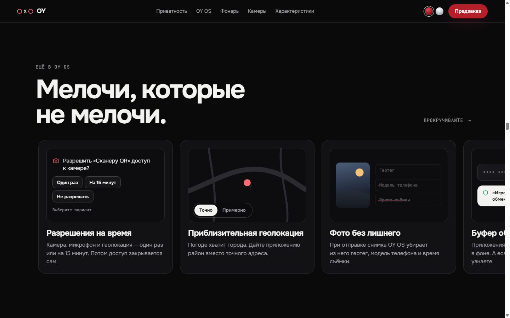
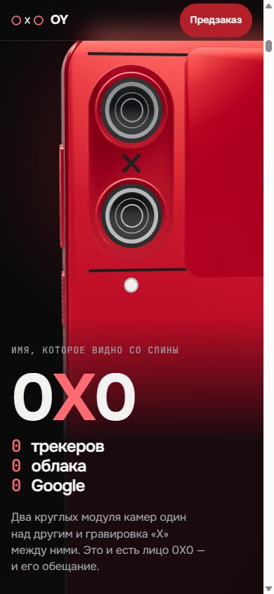

<div align="center">

# OY 0X0

**Ноль слежки. Ноль компромиссов.**

Промо-сайт семейства смартфонов OY в духе презентаций Apple: витрина, страницы OY 0X0 и OY 0X0 Pro
и сравнение. На каждой странице одна 3D-модель живёт за всем контентом, крутится, приближается
и раскрывает детали по мере прокрутки.

**[oy0x.online](https://oy0x.online)**

<sub>Концепт: OY 0X0, OY 0X0 Pro и компания OY вымышлены, телефоны не продаются.</sub>


</div>

---

## Страницы

| Адрес | Что там |
|---|---|
| [`/`](https://oy0x.online/) | Витрина: два телефона в 3D, выбор модели, главные различия, OY OS 2, «Чего здесь нет» |
| [`/0x0/`](https://oy0x.online/0x0/) | OY 0X0: шторка, три kill switch, сигнальный фонарь, экран 0,5–3500 нит |
| [`/pro/`](https://oy0x.online/pro/) | OY 0X0 Pro: Citadel, шифратор звонков, Claw, четыре kill switch, стеклянные грани, мрамор |
| [`/compare/`](https://oy0x.online/compare/) | Таблица сравнения с фильтром «только различия» |

<table><tr>
<td></td>
<td></td>
</tr><tr>
<td></td>
<td></td>
</tr></table>

## Что внутри

- **Одна модель на всю страницу.** Телефон отрисован в Three.js на fixed-canvas. Пока вы листаете, он разворачивается спинкой, приближается к камерам, облетает левую грань и ложится набок, чтобы показать фонарь.
- **Телефон в разборе.** Модель разлетается на слои: стекло, экран, рамка, плата, аккумулятор, спинка и шторка. Каждый слой подписан.
- **Механика двигается от скролла.** Шторка закрывает камеры, три kill switch выключаются по очереди, сигнальный фонарь загорается, и луч уходит вдаль.
- **Закреплённые секции и scrub.** GSAP ScrollTrigger и плавная прокрутка Lenis.
- **Два цвета корпуса.** «Сигнальный Красный» и «Арктический ледник». Смена за 0,7 с перекрашивает и модель, и акценты страницы. Выбор запоминается.
- **Экран, который гаснет.** Секция про яркость переходит из «3500 нит» на свету в «0,5 нита» в темноте, а интерфейс на экране модели переключается в красный ночной режим.
- **Интерактивные демо OY OS.** Журнал доступа, песочница, DNS-фильтр, разрешения на время, приблизительная геолокация, SOS фонарём азбукой Морзе и другие.
- **Приёмы со страниц Apple.** Карусель «Коротко о главном» с автопрокруткой, прогрессом на точке и паузой. Абзац, который загорается по словам. Градиентные заголовки. Телефон можно покрутить мышью или пальцем.
- **Конфигуратор.** Переключатель памяти меняет цену, в долларах крупно и в евро с пометкой «Европа — скоро».

## Скриншоты

| | |
|---|---|
|  |  |
| **0X0.** Вертикальная пара камер и гравировка «X» | **Шторка.** «Он умеет закрывать глаза» |
|  |  |
| **Kill Switches.** Камера и микрофон, связь, геолокация | **Сигнальный фонарь.** Белый и красный, видимость до 5000 м |
|  |  |
| **Экран.** От 3500 до 0,5 нита | **OY OS.** Горизонтальная лента интерактивных демо |
|  |   |
| **«Арктический ледник».** Цвет меняет всю страницу | **Мобильная версия.** Модель сверху, текст снизу |
|  |  |
| **По слоям.** Разлёт модели на скролле | **Коротко о главном.** Карусель с автопрокруткой |

## Запуск

Сборщик не нужен: это чистые HTML, CSS и ES-модули. Нужен только любой локальный сервер, потому что браузер не загружает GLB по `file://`.

```bash
git clone https://github.com/Arbuzyakaby/oy-0x0.git
cd oy-0x0
npx serve .
```

Вместо `npx serve` подойдёт `python -m http.server 8000`. Откройте `http://localhost:3000/` — витрина, оттуда ссылки на модели.

Параметры адреса для отладки:

| Параметр | Что делает |
|---|---|
| `?fallback` | Показывает процедурную модель, как при ошибке загрузки GLB |
| `?debug` | Открывает в консоли `window.__oy` (состояние сцены, ScrollTrigger) |

## Как это устроено

```
index.html            витрина семейства
0x0/index.html        страница OY 0X0
pro/index.html        страница OY 0X0 Pro
compare/index.html    сравнение моделей
404.html              страница «не найдено» (автономная, без JS)
og.jpg                превью ссылки для мессенджеров и соцсетей, 1200×630
css/core.css          общие стили: токены, типографика, шапка, подвал, карусель
css/0x0.css           стили страницы 0X0 (Pro переиспользует компоненты)
css/pro.css · home.css стили Pro, витрины и сравнения
js/core/              ядро: 3D-сцена, ключевые кадры, прокрутка, тексты, карусель, UI
js/models/oy0x0.js    3D-модель 0X0: материалы, механика, экран, резервная модель
js/models/pro.js      3D-модель Pro: матовое стекло, процедурный мрамор, Citadel, антенны Claw
js/data/products.js   цены, цвета и сравнение моделей — единственный источник
js/pages/             хореография страниц: base.js (0X0), pro.js, home.js, compare.js
models/               oy0x0.glb (~16 тыс. треугольников) и oy0x0-pro.glb (~22 тыс.)
blender/              скрипты сборки и превью модели
tests/                юнит-тесты (npm test) и регрессия страницы 0X0
docs/                 скриншоты, спецификации и планы
```

**Хореография модели.** Поза телефона, положение шторки, ползунков и яркость фонаря задаются ключевыми кадрами, привязанными к ScrollTrigger каждой секции. На каждом тике текущая прокрутка превращается в целевое состояние, а сцена плавно его догоняет. Поэтому модель всегда в правильной позе, даже если резко прыгнуть по якорю в середину страницы. HTML-подписи (статус шторки, состояния ползунков, текст про яркость) берут значения из того же источника и не расходятся с 3D.

**Модель** собрана из кода в Blender, без ручного моделирования:

```bash
blender -b -P blender/build_oy0x0.py
blender -b -P blender/build_oy0x0_pro.py   # модель Pro, общие хелперы — blender/oy_common.py
```

Скрипт строит телефон с нуля и экспортирует `models/oy0x0.glb`. Подвижные части вынесены в отдельные ноды (`Shutter`, `Switch_1..3`, `SignalLight`, `Screen`), а материалы (`Body`, `Frame`, `Shutter`, `SignalLightGlow` и другие) названы так, чтобы сайт мог к ним обращаться. Проверено на Blender 5.2, рассчитано на 4.x и 5.x. Превью с разных ракурсов:

```bash
blender -b -P blender/preview_render.py -- models/oy0x0.glb preview
```

Добавьте `--closed`, чтобы отрендерить закрытую шторку и ползунки в положении «выкл».

**Если GLB не загрузился**, `js/models/oy0x0.js` строит упрощённую модель прямо в браузере, с теми же именами деталей. Сайт работает всегда.

## Приватность

Сайт телефона без Google сам тоже ничего не отдаёт Google:

- никакой аналитики, трекеров, cookies и сторонних эмбедов;
- внешние запросы только к `cdn.jsdelivr.net` (библиотеки) и `fonts.bunny.net` (шрифты);
- Content Security Policy в `index.html` разрешает только эти домены;
- в `localStorage` хранится только выбранный цвет корпуса.

Откройте вкладку «Сеть» в DevTools и проверьте сами.

## Доступность и производительность

- Семантическая разметка, подписи для иконок, видимый фокус, контраст текста не ниже AA.
- Переключатели цвета, памяти, фонаря и демо OY OS работают с клавиатуры.
- `prefers-reduced-motion`: без закреплений, плавной прокрутки и параллакса, только простые появления.
- `devicePixelRatio` ограничен двумя. Рендер останавливается, когда 3D-секции не видны или вкладка скрыта.
- Корректно работает на экранах от 360 px.

## Стек

[Three.js](https://threejs.org/) 0.180 · [GSAP + ScrollTrigger](https://gsap.com/) 3.13 · [Lenis](https://lenis.darkroom.engineering/) 1.3 · [Blender](https://www.blender.org/) 5.2 · шрифты [Onest](https://fonts.bunny.net/family/onest) и [JetBrains Mono](https://fonts.bunny.net/family/jetbrains-mono) через Bunny Fonts
